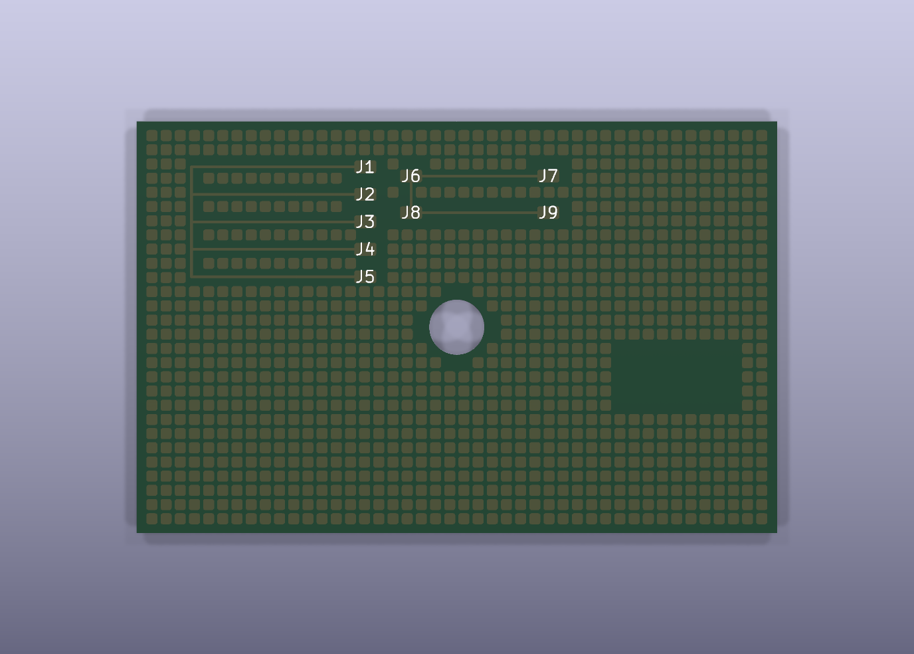

# Copper Thief / KiCad 盗铜生成器

在 `Edge.Cuts` 板框内，按规则阵列自动生成**圆形**或**圆角正方形**盗铜（copper thieving），并自动避让已有铜箔、板边、板框开槽、禁布区和钻孔。



> 上图由本插件在 `demo/copper_thief_demo.kicad_pcb` 上实际生成，并经过 KiCad 10.0.6 DRC 验证（0 violations / 0 unconnected）。

---

## 1. 功能

- 图案：圆形，或四边相等的圆角正方形。
- 可调直径 / 边长、圆角半径、阵列净间距。
- 可调铜箔间距、板边间距；实际值会与板级 DRC 规则取较大者。
- 在板框内自动居中，也可设置 X/Y 偏移。
- 支持任意铜层：F.Cu、B.Cu、内层。
- 自动避让：
  - 走线、圆弧走线、过孔、焊盘（含 PTH/NPTH/SMD/自定义焊盘）
  - 已填充的铜区（Zone），包括铜区中的孔洞
  - 铜层上的图形、文字、封装图形
  - 板框开槽、圆孔、异形孔
  - 焊盘/过孔钻孔（含槽孔）
  - 禁布区 / Rule Area（保守处理：整个区域都避开）
- 与已有铜箔相交、间距不足或落在板外时**自动跳过**，并在预览中统计跳过原因。
- 生成结果统一放在一个 `CopperThief` 组中，可用“删除现有盗铜”一键清理。
- 支持“同时避开相同网络铜箔”选项。
- 支持**项目配置文件** `<板名>.copper_thief.json`，可保存任意多个命名配置，下次打开项目直接选择复用。
- 再次生成时可选择“替换整个组”或“追加到同一个组”，不会产生多个难以管理的组。

---

## 2. 安装

### 方式 A：运行安装脚本（推荐）

在 PowerShell 中：

```powershell
cd C:\Users\lab\Desktop\copper_thief
powershell -ExecutionPolicy Bypass -File .\install.ps1
```

默认安装到：

```text
%APPDATA%\kicad\10.0\scripting\plugins\copper_thief
```

如果使用 KiCad 9，可指定版本：

```powershell
powershell -ExecutionPolicy Bypass -File .\install.ps1 -Version 9.0
```

### 方式 B：手动复制

把整个 `copper_thief` 文件夹复制到：

```text
C:\Users\<用户名>\AppData\Roaming\kicad\10.0\scripting\plugins\copper_thief
```

目录结构应为：

```text
...\scripting\plugins\copper_thief\
    __init__.py
    plugin.py
    dialog.py
    core.py
    board_adapter.py
    settings.py
    icon.png
```

然后**完全关闭并重新启动 KiCad PCB Editor**。

### 打开插件

PCB Editor 菜单：

```text
工具 / Tools -> 外部插件 / External Plugins -> Copper Thief (盗铜)
```

插件也会出现在工具栏（铜色圆点图标）。

---

## 3. 快速测试步骤

建议先复制一份 PCB 文件再测试，或先打开自带的 demo：

```text
demo\copper_thief_demo.kicad_pcb
```

### 3.1 在自带 demo 上测试

1. 用 KiCad PCB Editor 打开 `demo\copper_thief_demo.kicad_pcb`。
2. 打开 `工具 -> 外部插件 -> Copper Thief (盗铜)`。
3. 铜层勾选 `F.Cu`。
4. 网络选择 `<无网络>`（第一次测试建议这样，DRC 最干净）。
5. 图案选择“圆角正方形”。
6. 参数建议：
   - 尺寸：`1.2 mm`
   - 圆角半径：`0.25 mm`
   - 阵列间隙：`0.35 mm`
   - 铜箔间距：`0.20 mm`
   - 板边间距：`0.50 mm`
7. 点击“预览数量”，应看到约 1000 个可放置位置。
8. 点击“生成盗铜”。
9. 在 PCB 中查看 `CopperThief` 组；按 `E` 可查看任意一个图形的属性。
10. 打开 `检查 -> 设计规则检查器`，运行 DRC。demo 上应没有新增的间距/短路错误。

### 3.2 在自己的板子上测试

1. 先保存并备份 PCB。
2. 打开插件。
3. 先选择**一个铜层**（例如 `F.Cu`）和 `<无网络>`。
4. 用较小尺寸和较大间隙试跑：
   - 尺寸 `1.0 mm`
   - 间隙 `0.4 mm`
   - 铜箔间距 `0.2 mm`
   - 板边间距 `0.5 mm`
5. 点击“预览数量”，确认数量和跳过统计合理。
6. 点击“生成盗铜”。
7. 查看效果；如果不满意，点击“删除现有盗铜”后重新调整参数。
8. 最后再决定是否给盗铜指定网络。

---

## 4. 参数说明

| 参数 | 说明 |
|---|---|
| 铜层 | 可多选。每个铜层独立计算避让。 |
| 网络 | `<无网络>` 表示不分配网络；选择具体网络后图形会带上该网络。 |
| 形状 | 圆形 / 圆角正方形。圆角正方形四边相等，没有长方形。 |
| 尺寸 | 圆形为直径，正方形为边长。 |
| 圆角半径 | 仅正方形有效，范围 `0 .. 边长/2`。`0` 为直角，`边长/2` 近似圆。 |
| 阵列间隙 | 相邻图形**边缘到边缘**的净间距。中心距 = 尺寸 + 间隙。 |
| 铜箔间距 | 与其它网络铜箔的最小间距。会与板级最小间距、网络类规则、焊盘/铜区局部间距取较大值。 |
| 板边间距 | 与 `Edge.Cuts` 的最小间距。会与板级“铜到板边”规则取较大值。 |
| 自动居中 | 阵列在板框包围盒内居中。 |
| X/Y 偏移 | 在居中（或非居中）基础上平移整个阵列。 |
| 避开相同网络 | 勾选后，已有同网络铜箔也会被避开；取消后只避让不同网络。 |
| 最大尝试数 | 防止参数过小导致几十万次计算。超过会提示调整参数。 |

### 4.1 项目配置与多套参数

插件会在 **PCB 文件同目录**创建：

```text
<板名>.copper_thief.json
```

例如：

```text
uDap.copper_thief.json
```

使用方式：

1. 调整好一套参数；
2. 在“项目配置”下拉框中输入名称，例如“密集”“稀疏”“只 B.Cu”；
3. 点击“保存配置”；
4. 以后打开同一个 PCB，插件会自动读取该文件，选中名称即可载入全部参数；
5. 点“删除”可移除当前选中的配置。

配置文件同时保存：铜层、网络、形状、尺寸、圆角、间隙、间距、偏移、最大尝试数等。

注意：

- 如果 PCB 还没保存到磁盘，无法确定项目目录，此时“保存配置”会提示先保存 PCB。
- 预览或生成盗铜时，当前配置也会自动写入项目配置文件。
- 项目配置和全局设置是两层：项目配置优先；没有项目配置时使用上一次的全局参数。

### 4.2 生成组

所有生成的铜图形会放入同一个 `CopperThief` 组：

- 勾选“生成前删除上一次生成的盗铜”：先删除旧组，再创建一个新组；
- 取消勾选：新图形追加到已有的同一个 `CopperThief` 组，不会产生第二个组。

这样在 KiCad 的组列表中可以一次性选中、隐藏或删除整组盗铜。

---

## 5. 规则与避让说明

插件在生成前会读取：

- 板框 `Edge.Cuts`（含开槽/挖孔）
- 板级设计规则：
  - 最小铜箔间距
  - 铜到板边间距
  - 铜到钻孔间距
- 网络类（Netclass）间距
- 焊盘/铜区/走线的局部间距覆盖（Local Clearance）
- 所有选中铜层上的铜箔：
  - 走线、圆弧走线、过孔
  - 焊盘、通孔、NPTH
  - Zone 的已填充铜皮
  - 铜层上的图形、文字、封装图形
- 禁布区 / Rule Area（保守地整个避开）
- 钻孔和槽孔

任何一个候选位置不满足上述条件都会被跳过，并计入“跳过原因”统计。

### 重要：自定义 DRC 规则

KiCad 的 `.kicad_dru` 自定义规则（例如按区域、按网络名、按封装设置特殊间距）**不会**被插件解析。插件只使用板级设置、网络类和局部间距。生成后仍建议运行一次 DRC。

---

## 6. 关于“指定网络”和 DRC 未连接提示

盗铜通常是**孤立的铜岛**。

- 选择 `<无网络>`：
  - 不会产生网络未连接提示，DRC 最干净。
  - 适合作为纯铜平衡/蚀刻均匀性用途。
- 选择具体网络（例如 `GND`）：
  - 生成的每个图形都会带上该网络。
  - 因为孤岛之间没有走线连接，KiCad DRC 会出现 `unconnected items`（未连接项目）提示。
  - 这是孤立盗铜的电气特性，不是间距/短路错误。
  - 如果必须连接到 GND，请在版图后期用走线、过孔或铜皮把它们连到 GND；或者接受/排除这些未连接提示。
  - 也可以取消“同时避开相同网络的铜箔”，让盗铜有机会与已有同网络铜皮重叠/合并；但是否真正连通仍取决于版图几何。

插件界面和生成后的提示中也会说明这一点。

---

## 7. 找不到可放置位置怎么办

先点 **诊断/导出报告**，插件会生成：

```text
%APPDATA%\kicad\10.0\copper_thief_diagnostic.txt
```

报告会列出板框尺寸、每个铜层的铜箔数量、最大的铜箔/铺铜范围，以及候选位置和跳过原因。把该文件或“结果”框截图发给我即可定位。

也可以点“预览数量”，查看状态栏中的跳过统计：

- **候选位置为 0**：板框内连一个图形都放不下。减小尺寸/圆角/板边间距，并确认 `Edge.Cuts` 没有多余线段。
- **铜箔跳过最多**：所选铜层几乎被已有走线、焊盘或铺铜覆盖。常见原因是该层有一整片 GND 铺铜。
  - 换一个没有整片铺铜的铜层；
  - 如果就是要用 GND 铺铜层，选择 `GND` 网络并取消“同时避开相同网络的铜箔”，让盗铜与铺铜合并（但可能看不出独立铜岛）；
  - 先在铺铜上挖出阵列窗口/禁布区，再生成。
- **禁布跳过最多**：检查 Rule Area / Keepout 是否覆盖了可用区域。
- **板边跳过最多**：检查板框、开槽、挖孔，或减小板边间距。
- **钻孔跳过最多**：可用区域钻孔/安装孔较多，换区域或减小铜箔间距。

未填充或填充数据为空的 Zone 不包含实际铜皮，本插件会忽略它（不会再按轮廓整片避开）。如果希望这些 Zone 参与避让，请先在 KiCad 中重灌铜（`编辑 -> 填充所有铜区`）再试。诊断报告会显示 `unfilled_zones=` 数量。插件日志位于：

```text
%APPDATA%\kicad\10.0\copper_thief.log
```

## 8. 已知限制

- 阵列为**轴对齐规则网格**，暂不支持旋转阵列、交错/蜂窝阵列。
- 只支持圆形和圆角正方形，不支持长方形。
- 未填充/空填充的 Zone 没有实际铜皮，会被忽略；建议先重灌铜再做精确避让。
- Rule Area 无论具体限制类型（禁止过孔/禁止铺铜等）都整体避开（偏保守）。
- 圆弧板框会按 KiCad 多边形离散化，并额外保留 2 µm 规划余量。
- 自定义 `.kicad_dru` 规则不参与计算。
- 生成项是铜层图形（`PCB_SHAPE`），不是焊盘；会放在 `CopperThief` 组中。
- 插件通过 Python API 直接修改当前板，生成前请保存/备份。

---

## 9. 开发与测试

### 9.1 纯逻辑测试（不需要 KiCad）

```powershell
python -m unittest tests.test_core tests.test_settings -v
```

### 9.2 KiCad 集成测试（需要 pcbnew + kicad-cli）

使用 KiCad 自带的 Python（把路径改成你的 KiCad `bin\python.exe`）：

```powershell
$env:COPPER_THIEF_NO_REGISTER = "1"
$env:COPPER_THIEF_SETTINGS = "$PWD\tests\_artifacts\settings.json"
$py = "C:\Program Files\KiCad\10.0\bin\python.exe"
& $py -m unittest tests.test_integration -v
```

测试会：

1. 构造带板框、开槽、走线、焊盘、过孔、Zone、禁布区的板。
2. 生成盗铜。
3. 保存 PCB。
4. 调用 `kicad-cli pcb drc`。
5. 断言没有间距/短路/钻孔相关违规。

### 9.3 重新生成 demo

```powershell
$env:COPPER_THIEF_NO_REGISTER = "1"
$py = "C:\Program Files\KiCad\10.0\bin\python.exe"
& $py demo\make_demo.py
```

---

## 10. 目录结构

```text
copper_thief/
  __init__.py           KiCad 插件注册入口
  plugin.py             ActionPlugin
  dialog.py             wxPython 界面
  core.py               纯 Python 几何、避让、阵列规划
  board_adapter.py      pcbnew 读取/生成适配层
  settings.py           参数持久化
  icon.png              插件图标
  install.ps1           Windows 安装脚本
  .github/workflows/release.yml  v* 标签自动构建并发布 Release
  tests/
    test_core.py        算法单元测试
    test_settings.py    项目配置/多配置读写测试
    test_integration.py pcbnew + DRC 集成测试
  demo/
    make_demo.py        demo 生成脚本
    copper_thief_demo.kicad_pcb
    preview.png
```

运行插件后，PCB 同目录会生成：

```text
<板名>.copper_thief.json
```

---

## 11. 版本记录

- **1.2.0**：新增 PCB 同目录项目配置文件 `<板名>.copper_thief.json`，支持任意多个命名配置的保存、载入和删除；生成项始终归入同一个 `CopperThief` 组，支持替换或追加；新增 `v*` 标签自动构建并发布 GitHub Release 的 workflow。
- **1.1.0**：修复“有 Zone 轮廓但没有实际填充数据”时被误判为整板铜皮、导致 0 个可放置位置的问题；未填充/空填充 Zone 现在会被忽略。新增“诊断/导出报告”按钮。
- **1.0.0**：初始版本。

## 12. 许可

MIT License，见 [LICENSE](LICENSE)。
